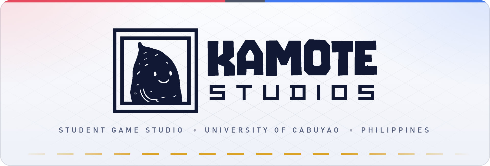
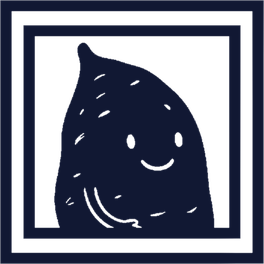
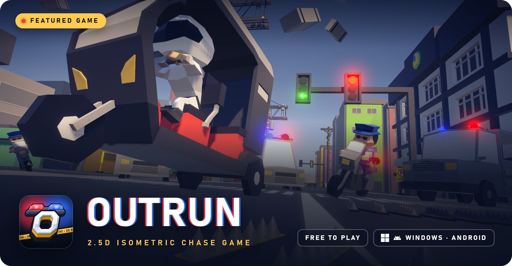
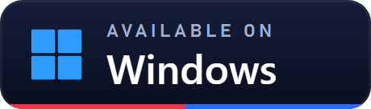
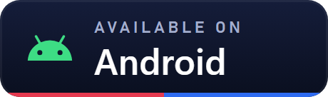
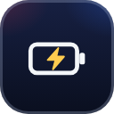
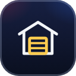
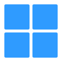
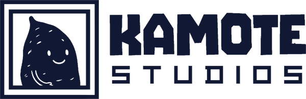

<!--
  Kamote Studios · Organization profile README
  Rendered at https://github.com/Kamote-Studios

  Images are referenced by absolute URL so they resolve on the organization page.
  Theme-aware images use picture/source elements, so GitHub light and dark themes
  each get a matching version ("-light" / "-dark" files in assets/readme).
  Graphics are generated from the templates in /design (see the repository README).
-->

<picture>
  <source media="(prefers-color-scheme: dark)" srcset="https://raw.githubusercontent.com/Kamote-Studios/.github/main/assets/readme/kamote-studios-hero-dark.png">
  <source media="(prefers-color-scheme: light)" srcset="https://raw.githubusercontent.com/Kamote-Studios/.github/main/assets/readme/kamote-studios-hero-light.png">
  
</picture>

 
 

**Kamote Studios** is a student game studio from the **University of Cabuyao**, Philippines. 
We are the team behind **OUTRUN**, a free-to-play 2.5D chase game for Windows and Android.

 

[About](#about-us) &nbsp;·&nbsp; [Why Kamote](#why-kamote) &nbsp;·&nbsp; [OUTRUN](#outrun) &nbsp;·&nbsp; [Features](#features) &nbsp;·&nbsp; [Controls & Requirements](#controls-and-system-requirements)

 

<picture>
  <source media="(prefers-color-scheme: dark)" srcset="https://raw.githubusercontent.com/Kamote-Studios/.github/main/assets/readme/divider-road-dark.png">
  <source media="(prefers-color-scheme: light)" srcset="https://raw.githubusercontent.com/Kamote-Studios/.github/main/assets/readme/divider-road-light.png">
  
</picture>

## About Us

**Kamote Studios** is a game development team of Computer Science students from the **University of Cabuyao** (*Pamantasan ng Cabuyao*) in Cabuyao City, Laguna, Philippines. We build original games from the ground up and release them for both PC and mobile, so anyone with a laptop or a phone can play.

Our name is a local joke, and we bring that same playful, unmistakably Filipino attitude to the games we make.

### Why Kamote?

<table>
  <tr>
    <td width="112" align="center">
      <picture>
        <source media="(prefers-color-scheme: dark)" srcset="https://raw.githubusercontent.com/Kamote-Studios/.github/main/assets/readme/kamote-studios-mascot-dark.png">
        <source media="(prefers-color-scheme: light)" srcset="https://raw.githubusercontent.com/Kamote-Studios/.github/main/assets/readme/kamote-studios-mascot-light.png">
        
      </picture>
    </td>
    <td>
      <b>ka·mo·te</b> &nbsp;<i>/kaˈmo.te/</i> &nbsp;·&nbsp; <i>noun</i> &nbsp;·&nbsp; Tagalog
        
      <b>1.</b> Sweet potato. 
      <b>2.</b> <i>(slang)</i> A reckless, undisciplined rider who ignores traffic laws and road safety. Usually heard as <b>“kamote rider,”</b> and used to poke fun at poor driving, carelessness, or plain incompetence on the road.
    </td>
  </tr>
</table>

We took the name with a wink. Anyone who has spent time on Philippine roads has met a kamote rider. In our games you get to be one, and the only thing you can wreck is your run.

> **Ride responsibly.** Kamote riding belongs on screen, not on real streets. Follow traffic laws, wear a helmet, and look out for everyone on the road.

 
<picture>
  <source media="(prefers-color-scheme: dark)" srcset="https://raw.githubusercontent.com/Kamote-Studios/.github/main/assets/readme/divider-road-dark.png">
  <source media="(prefers-color-scheme: light)" srcset="https://raw.githubusercontent.com/Kamote-Studios/.github/main/assets/readme/divider-road-light.png">
  
</picture>

## OUTRUN

 
 

**OUTRUN** is a 2.5D isometric chase game set in a dense city. 
Ride through traffic, manage your battery and durability, and stay ahead of a police pursuit that grows stronger the longer you survive.

 

<!-- To make these buttons clickable, wrap each <picture> in <a href="DOWNLOAD-LINK"> … </a>. -->
<picture>
  <source media="(prefers-color-scheme: dark)" srcset="https://raw.githubusercontent.com/Kamote-Studios/.github/main/assets/readme/badge-windows-dark.png">
  <source media="(prefers-color-scheme: light)" srcset="https://raw.githubusercontent.com/Kamote-Studios/.github/main/assets/readme/badge-windows-light.png">
  
</picture>
&nbsp;&nbsp;
<picture>
  <source media="(prefers-color-scheme: dark)" srcset="https://raw.githubusercontent.com/Kamote-Studios/.github/main/assets/readme/badge-android-dark.png">
  <source media="(prefers-color-scheme: light)" srcset="https://raw.githubusercontent.com/Kamote-Studios/.github/main/assets/readme/badge-android-light.png">
  
</picture>

<b>FREE TO PLAY</b> &nbsp;·&nbsp; SINGLE-PLAYER &nbsp;·&nbsp; PLAYS OFFLINE

### Features

<table>
  <tr>
    <td width="76" align="center"></td>
    <td>
      <b>Escalating pursuit</b> 
      The longer you evade, the higher your heat and the heavier the police response. Patrol cars, motorcycles, roadblocks, spike strips, and officers on foot close in. Break line of sight to cool the search and find another route.
    </td>
  </tr>
  <tr>
    <td align="center"></td>
    <td>
      <b>Battery and durability</b> 
      Sprinting drains the battery faster, low charge reduces top speed, and crashes wear down durability. Spare batteries are scattered across the city. If durability fails, the run ends.
    </td>
  </tr>
  <tr>
    <td align="center"></td>
    <td>
      <b>The city</b> 
      A dense map of roads, alleys, and crosswalks, with moving traffic, pedestrians, and hazards.
    </td>
  </tr>
  <tr>
    <td align="center"></td>
    <td>
      <b>The garage</b> 
      Start with an e-bike and unlock six additional rides, including a wheelchair and a shopping cart. Earn Meter Points (MP) by riding farther and sustaining higher heat, then spend them on rides or on Battery Capacity, Durability, and Motor upgrades.
    </td>
  </tr>
  <tr>
    <td align="center"></td>
    <td>
      <b>Local scoreboard</b> 
      Track lifetime distance, collisions, batteries collected, runs, and how each run ended. Owned rides, upgrades, and stats are saved locally.
    </td>
  </tr>
</table>

### Controls and System Requirements

<table>
  <thead>
    <tr>
      <th align="left" width="170"></th>
      <th align="left">&nbsp; Windows</th>
      <th align="left">&nbsp; Android</th>
    </tr>
  </thead>
  <tbody>
    <tr>
      <td colspan="3">&nbsp; <b>CONTROLS</b></td>
    </tr>
    <tr>
      <td>Move</td>
      <td><kbd>W</kbd> <kbd>A</kbd> <kbd>S</kbd> <kbd>D</kbd> &nbsp;or&nbsp; <kbd>↑</kbd> <kbd>←</kbd> <kbd>↓</kbd> <kbd>→</kbd></td>
      <td>On-screen joystick</td>
    </tr>
    <tr>
      <td>Sprint</td>
      <td><kbd>Shift</kbd></td>
      <td><code>SPRINT</code> button</td>
    </tr>
    <tr>
      <td>Pause</td>
      <td><kbd>Esc</kbd></td>
      <td><code>PAUSE</code> button</td>
    </tr>
    <tr>
      <td>Menus</td>
      <td>Mouse</td>
      <td>Touch</td>
    </tr>
    <tr>
      <td colspan="3">&nbsp; <b>SYSTEM REQUIREMENTS</b></td>
    </tr>
    <tr>
      <td>Operating system</td>
      <td>Windows 10 / 11 (64-bit)</td>
      <td>Android 7.1 or later</td>
    </tr>
    <tr>
      <td>Input</td>
      <td>Keyboard and mouse</td>
      <td>Touchscreen</td>
    </tr>
    <tr>
      <td>Mode</td>
      <td>Single-player, offline</td>
      <td>Single-player, offline</td>
    </tr>
    <tr>
      <td>Price</td>
      <td>Free to play</td>
      <td>Free to play</td>
    </tr>
  </tbody>
</table>

 
<picture>
  <source media="(prefers-color-scheme: dark)" srcset="https://raw.githubusercontent.com/Kamote-Studios/.github/main/assets/readme/divider-road-dark.png">
  <source media="(prefers-color-scheme: light)" srcset="https://raw.githubusercontent.com/Kamote-Studios/.github/main/assets/readme/divider-road-light.png">
  
</picture>
 
 
<picture>
  <source media="(prefers-color-scheme: dark)" srcset="https://raw.githubusercontent.com/Kamote-Studios/.github/main/assets/readme/kamote-studios-logo-dark.png">
  <source media="(prefers-color-scheme: light)" srcset="https://raw.githubusercontent.com/Kamote-Studios/.github/main/assets/readme/kamote-studios-logo-light.png">
  
</picture>

Made by Computer Science students of the University of Cabuyao (Pamantasan ng Cabuyao) · Laguna, Philippines 
© 2026 Kamote Studios. OUTRUN and all related names, logos, and artwork are property of Kamote Studios.

